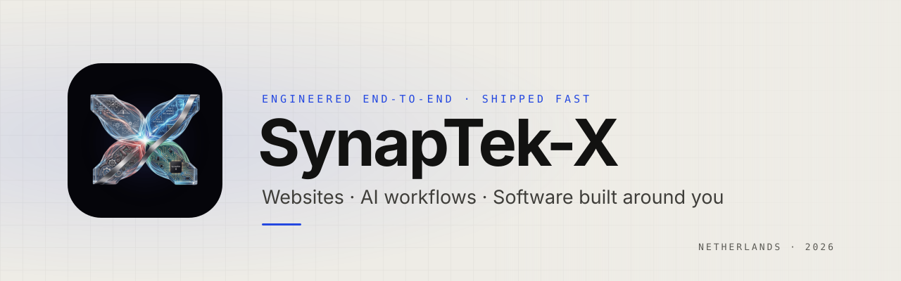

<picture>
  <source media="(prefers-color-scheme: dark)" srcset="./assets/banner-dark.svg">
  
</picture>

 

**SynapTek-X** is an engineering studio for small and medium-sized businesses in the Netherlands. We build the digital side of a business — the website your customers find, the workflows that give your team its hours back, and the software that fits how you actually operate. One team, from first brief to launch.

### What we do

| Websites & presence | AI workflows | Custom software |
| :-- | :-- | :-- |
| Fast, accessible, multilingual sites (EN · NL · TR) built to turn visitors into customers. | Automations and AI agents that take repetitive work off your team’s plate — with a human in the loop. | Web, desktop and device software shaped around your operation — from checkout to the screens on your wall. |

We also build our own products for hospitality — point of sale and digital menu boards. More soon.

### How we work

- **Evidence, not claims.** Nothing is “done” until a check you can see passes.
- **Security first.** Secrets never live in code, and every change is scanned before it ships.
- **Private by design.** Client work stays private — always.
- **End to end.** Strategy, design, engineering and launch under one roof.

### Stack

`TypeScript` `React` `Next.js` `Vite` `Tailwind CSS` `Motion` `Three.js` 
`Node.js` `NestJS` `Fastify` `Prisma` `PostgreSQL` `Redis` `Socket.IO` 
`Electron` `Tauri` `Rust` · `Claude` `ONNX Runtime` `MediaPipe` 
`Vitest` `Playwright` `Zod` `Docker`

 

Website launching soon · Netherlands · © 2026 SynapTek-X
